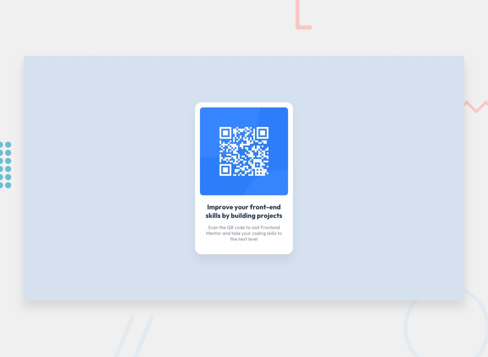
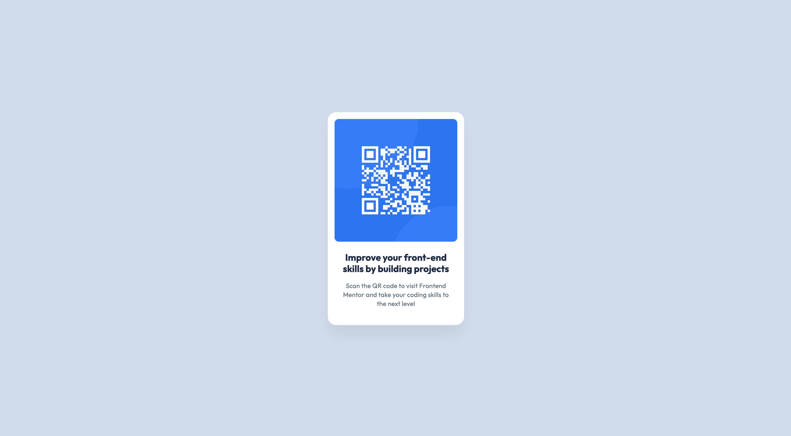

# Frontend Mentor - QR code component solution

This is a solution to the [QR code component challenge on Frontend Mentor](https://www.frontendmentor.io/challenges/qr-code-component-iux_sIO_H).

## Table of contents

- [Overview](#overview)
  - [Screenshot](#screenshot)
  - [Extra Feature](#extra-feature)
  - [Links](#links)
- [My process](#my-process)
  - [Built with](#built-with)
  - [What I learned](#what-i-learned)
  - [AI Collaboration](#ai-collaboration)

## Overview

### Screenshot

#### Design preview

#### Desktop

#### Desktop on hover

### Extra Feature

**As a** desktop user, 
**I want to** see the QR code zoom in when I hover it, 
**so that** it is easier to scan.

### Links

- Repository URL: [GitHub Repo](https://github.com/MATBMS/qr-code-component)
- Live Site URL: [GitHub Page](https://matbms.github.io/qr-code-component/)

## My process

### Built with

- Semantic HTML5 markup
- CSS custom properties
- Flexbox

### What I learned

- **`transform` vs. `width` / `height`:** `transform: scale()` changes how the image looks without changing the layout, so the text and the card do not move. A bigger `width` and `height` would make the box really bigger and push everything around it. `scale` also grows the image from its center, in all directions, and is smoother to animate.
- **Where to write the `transition`:** I write it on the normal rule (`.card__qr`), not inside `:hover`. This way it animates both when the mouse enters and when it leaves. Inside `:hover`, only the zoom in would be animated and the image would jump back when the mouse leaves.
- **`:root` and `box-sizing: border-box`:**
  - `:root` is the top element of the page (`html`). CSS variables declared there are inherited by every element, so I can use them anywhere.
  - `box-sizing: border-box` makes the `width` include the padding and the border. A card with `max-width: 20rem` stays 20rem wide, with no calculation.
- **`main` and the empty `alt`:**
  - `main` marks the main content of the page (only one per page). Screen readers can jump straight to it, which they cannot do with a `div`.
  - An empty `alt` tells screen readers to skip the image, as if it were decoration. It is fine for a decorative image, but wrong for the QR code, which carries information.

### AI Collaboration

This is a project where I act as the Product Engineer, not the developer. I define the requirements and validate every decision, and Claude Code writes the code.
